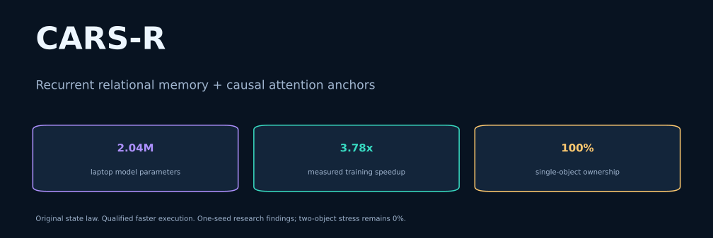
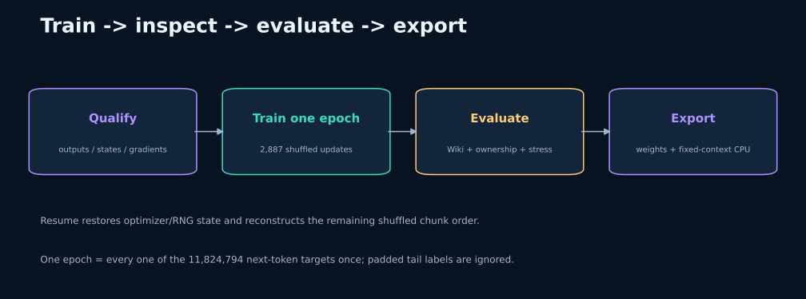

<p align="center"></p>

# CARS-R · Research

[](https://github.com/Bharath122babu/CARS-R-Research/actions/workflows/ci.yml) [](https://github.com/Bharath122babu/CARS-R-Research/actions/workflows/docs.yml)

**A small hybrid language model that transforms recurrent history, reads it before writing, and corrects it with new evidence.**

CARS-R combines three recurrent CARS blocks with one causal Multi-head Latent Attention (MLA) anchor. This repository contains the original mathematical reference, a qualified faster execution path, matched Transformer/KDA/GDN-2 baselines, and a complete one-epoch runner for laptop experiments.

The measured fast run trained **3.78× faster** while preserving **100% single-object ownership accuracy**. This is a research result from one seed. The original two-object stress failure remains visible below.

[Architecture](docs/ARCHITECTURE.md) · [Measured results](docs/RESULTS.md) · [Training guide](docs/TRAINING.md) · [Dataset](docs/DATA.md) · [Reproducibility](docs/REPRODUCIBILITY.md)

## Quick start

Tested locally with **Python 3.12, PyTorch 2.6.0+cu124, and an RTX 4070 Laptop GPU**. Use a CUDA-enabled PyTorch installation for GPU training. The dependencies below preserve an already-installed compatible PyTorch.

```bash
python -m pip install -e ".[test,comparison]"
python cars_epoch.py --epochs 1
```

On Windows, double-click **`START_EPOCH.cmd`** from this folder, or paste:

```cmd
python -u cars_epoch.py --epochs 1
```

This command verifies/prepares the pinned dataset, qualifies the fast operator, trains **one complete shuffled epoch**, evaluates the validation-selected checkpoint, and exports weights plus fixed-context CPU TorchScript. It resumes when the same command is rerun.

**One epoch:** 2,887 optimizer updates and 11,824,794 real next-token targets. At the previous measured speed, expect roughly **25 minutes of training plus qualification/evaluation/export**; this is an estimate, not a measured completed epoch. The next epoch experiment has not been run for this release.

The local folder includes prepared data and the prior reference/fast checkpoints. Those large assets are Git-ignored. A source-only GitHub clone can recreate the dataset from its pinned revision; qualification then uses a seeded untrained model if historical reference weights are absent. See [local assets](docs/LOCAL_ASSETS.md).

## Architecture at a glance


| Component | Laptop configuration |
|---|---|
| Parameters | 2,044,068; tied token embedding/output head |
| Backbone | Width 192; 4 layers; 4 heads; SwiGLU width 576 |
| Layer schedule | CARS → CARS → CARS → causal MLA |
| Memory per CARS head | A learned continuous 32 × 32 matrix |
| Evidence rank | 2 key/value directions per token and head |
| Tokenizer | UTF-8 bytes + PAD/BOS/EOS; vocabulary 259 |
| Training context | 128; configured maximum 512 |
| Arithmetic | BF16 projections on CUDA; FP32 recurrence |

Each block uses pre-RMSNorm, a sequence mixer, residual addition, and a pre-RMSNorm SwiGLU feed-forward residual. The attention anchor provides access to the causal token history. Consequently, the complete hybrid includes attention memory; the fixed-size CARS state does not make the entire model constant-memory.

## Transport → read → correct


The current hidden vector produces a query, key/value evidence, and transport directions. The previous state is rotated with an input-conditioned orthogonal Cayley transform and decayed with a learned head timescale. The model reads this transformed history **before** current evidence enters the state.

For one head:

$$\Omega_t=\eta_t(u_tw_t^\top-w_tu_t^\top),\qquad T_t=(I-\Omega_t/2)^{-1}(I+\Omega_t/2)$$

$$\bar S_t=\delta_hS_{t-1}T_t,\qquad r_t=\bar S_tq_t$$

$$E_t=V_t-\bar S_tK_t,\qquad S_t=\bar S_t+E_t(K_t^\top K_t+\lambda_hI)^{-1}K_t^\top$$

The read is normalized, scaled and projected back to the model width. The write is a ridge minimum-change correction: it fits current evidence while penalizing the size of the update. The ridge system uses Cholesky solves. The [architecture note](docs/ARCHITECTURE.md) explains the dimensions, initialization, fast factorization and stability limits.

## Measured execution improvement


The faster path computes input-only transport factors and ridge solves once for the whole sequence. The state still evolves sequentially. It retains the same state law, with a different floating-point operation order; it is portable PyTorch rather than a custom fused CUDA kernel.

| Same 1,000-step recipe, seed 1337 | Original OG | Fast path |
|---|---:|---:|
| Logged training-step minutes | 29.76 | **7.88** |
| Wiki byte-token NLL ↓ | 1.54078 | **1.54021** |
| Original ownership IID, 500 cases | 100% | **100%** |
| Fresh ownership, 2,000 cases | 100% | **100%** |
| Five transfers, 256 cases | 100% | **100%** |
| Peak allocated CUDA memory | 975 MiB | **708 MiB** |

The new full training wall time was **8.38 minutes**, including startup, validation, diagnostics, checkpoint saves and a two-step resume probe. Evaluation/export add further time. The tiny NLL difference is not evidence of an accuracy improvement. Both checkpoints were scored using the original operator on the same 1,024 Wiki windows and identical ownership cases. Raw evidence is in [`reports/`](reports/).

## What ownership really measures


An ownership example asks which person owns an object after transfers:

```text
A owns x. A gives x to B. B gives x to C. Owner of x: C
```

Candidate accuracy picks among owners **A–H** after an appended space. Unrestricted space-and-owner accuracy is recorded separately. IID means held-out examples from the same single-object generator; it does not mean general reasoning or overall language accuracy.

Both original and fast CARS score **0%** on the two-object distractor and unchanged-query stress sets. Answers follow the last recipient even when another object was transferred. The fresh set contains 1,999 three-transfer cases and one two-transfer case because most two-transfer combinations were already used in the original splits.

## Initial baseline findings

These are approximately parameter-matched **local PyTorch baselines**, all trained for 1,000 steps on 4.096M prediction tokens, seed 1337. KDA/GDN-2 use the same hybrid backbone. These timings do not represent upstream fused kernels or large published models.

| Model | Wiki NLL ↓ | IID ownership | Five transfers | Two-object distractor | Training min |
|---|---:|---:|---:|---:|---:|
| Original CARS-R | 1.54078 | 100% | 100% | 0% | 29.76 |
| Transformer | 1.52637 | 22.4% | 15.6% | 13.7% | 0.48 |
| KDA hybrid | **1.50294** | 98.0% | 98.8% | 1.6% | 7.98 |
| GDN-2 hybrid | 1.51235 | 99.8% | 100% | 0.4% | 7.83 |
| Fast CARS-R | 1.54021 | 100% | 100% | 0% | **7.88** |

CARS has strong single-object performance in this test. KDA has the best Wiki NLL in this comparison; the Transformer is fastest. There is no demonstrated overall architecture winner.

## Training and evaluation workflow



The original recipe uses AdamW `(0.9, 0.95)`, peak LR `4e-4`, weight decay `0.1`, gradient clip `1.0`, 100 warmup updates and a cosine floor of `4e-5`. Validation selects the checkpoint; test suites report its performance. Every step logs loss, gradient norm, LR, throughput, memory and estimated time. Health probes track state norms, half-lives, ridge/read scales and transport strength.

```bash
# Repeat the historical random-window budget in a new run.
python cars_fast.py qualify
python cars_fast.py train --arm og --seed 1337
python cars_fast.py evaluate --run runs/fast/og_seed1337 --reference

# Read the completed epoch checkpoint without retraining.
python cars_fast.py evaluate --run runs/fast/epoch1_seed1337 --reference
```

The `lr8` and `state10` arms are unproven optional experiments. They were not trained in the reported speed comparison. More details, including exact resume restrictions and epoch padding, are in [TRAINING.md](docs/TRAINING.md).

## Numerical checks and project health

- The historical fast-enabled suite passed **69 tests**. Epoch coverage, deterministic sampler resume and ignored-padding gradients have additional tests.
- Qualification compares outputs, final states and gradients with the original FP64/FP32 operator, including masks, nonzero initial state, near-dependent keys and complete forgetting.
- A ten-step matched BF16 trajectory had maximum loss difference **0.000130**.
- Historical training had finite logged gradients and no skipped optimizer updates. These observations do not prove global stability.
- Original decay underflow in the submitted prototype was fixed; resume checks bind code/data/config/hardware before proceeding.
- Export checks changed inputs/mask lengths and reloads the compiled CPU artifact. Its batch/context are fixed at **1 × 128**; it is not GPU training compilation.

GitHub Actions test CPU reference/fast behavior on Windows and Linux and check documentation assets. The badges above link to the live workflow results. See [reproducibility](docs/REPRODUCIBILITY.md) for the local checks and hosted workflow scope.

The standalone copy passed **74/74 local fast-enabled tests**, **67 CPU source-only tests with 7 CUDA skips**, and GPU numerical qualification. Documentation links, all six SVG/PNG pairs, local asset hashes and the 2,887-update epoch plan were checked. See the [build validation record](docs/BUILD_VALIDATION.md).

## Repository map

```text
cars_r/                 complete model, baseline, training and export package
cars_fast.py            qualified factorized execution and controlled arms
cars_epoch.py           one shuffled pass; exact sampler resume; tail masking
configs/                laptop baselines and small smoke configurations
tests/                  causality, gradients, reference matching and resume
scripts/                figures, asset checks and reusable evaluation
docs/assets/            original SVG diagrams plus PNG copies
reports/                historical results, training logs and provenance
third_party/fla/        pinned MIT reference code used by baseline tests
data/                   local cache; regenerated from the pinned dataset
references/             reference config + optional local original weights
pretrained/             local measured fast weights and compiled CPU export
runs/                   new experiment outputs (Git-ignored)
```

Old release archives, build outputs, cache directories, rollback snapshots, duplicate handoffs and abandoned experiments are excluded from this copy. The full core model/baseline code is preserved. Existing source folders are unchanged.

## License and attribution

Project source: [MIT](LICENSE). FLA reference files retain their [upstream MIT license](third_party/fla/LICENSE) and pinned provenance in [`cars_r/baseline_sources.json`](cars_r/baseline_sources.json). WikiText data retains its pinned dataset card and attribution; see [DATA.md](docs/DATA.md). Numerical diagrams and charts are generated from [`scripts/make_figures.py`](scripts/make_figures.py).
