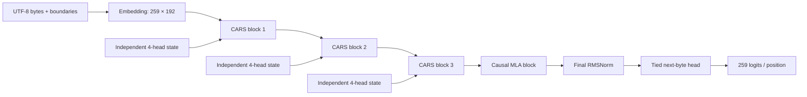
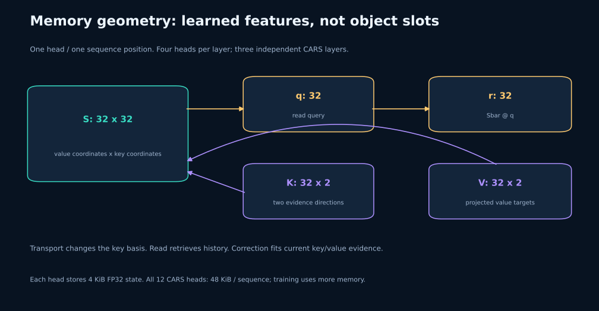
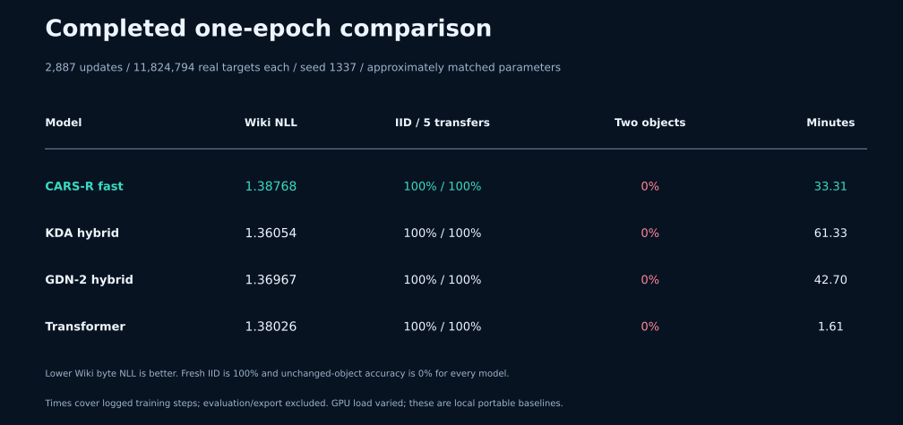

<p align="center"></p>

# CARS-R · Research

**A byte-level hybrid language model built around a transport → read → correct memory operator.**

[](https://github.com/Bharath122babu/CARS-R-Research/actions/workflows/ci.yml)
[](https://github.com/Bharath122babu/CARS-R-Research/actions/workflows/docs.yml)

**2.04M parameters · PyTorch reference + qualified fast execution · RTX 4070 Laptop experiments · Research implementation**

CARS-R gives each recurrent head a continuous matrix memory. At each byte position, the head transforms previous memory with an input-conditioned Cayley map, reads that transformed history, and writes a ridge-regularized correction based on new evidence. Three CARS blocks are followed by one causal Multi-head Latent Attention (MLA) block. Residual paths and SwiGLU feed-forward layers carry the current token representation throughout the model.

This repository contains the mathematical reference, factorized execution of the same recurrence, matched local Transformer/KDA/GDN-2 baselines, numerical checks, complete-epoch training, evaluation, and checked CPU exports.

**Current evidence:** factorized execution reduced historical CARS training-step time from **29.76 to 7.88 minutes** for 1,000 updates. The completed epoch gives CARS **1.38768 Wiki byte NLL**, compared with **1.36054 for KDA**. Every model reaches 100% on single-object ownership and 0% on both two-object stress suites. These findings motivate improved data and controlled architecture ablations; they do not establish an overall CARS quality advantage.

---

## Contents

1. [Overview and research questions](#overview-and-research-questions)
2. [One forward pass, end to end](#one-forward-pass-end-to-end)
3. [Architecture and configuration](#architecture-and-configuration)
4. [Notation and tensor shapes](#notation-and-tensor-shapes)
5. [The CARS memory operator](#the-cars-memory-operator)
6. [Residual blocks and the MLA anchor](#residual-blocks-and-the-mla-anchor)
7. [Factorized fast execution](#factorized-fast-execution)
8. [Causality and state lifetime](#causality-and-state-lifetime)
9. [Training data and objective](#training-data-and-objective)
10. [Completed experiments](#completed-experiments)
11. [What ownership accuracy means](#what-ownership-accuracy-means)
12. [Installation and training](#installation-and-training)
13. [Evaluation, generation, and export](#evaluation-generation-and-export)
14. [Numerical checks and continuous integration](#numerical-checks-and-continuous-integration)
15. [Repository and source map](#repository-and-source-map)
16. [Research roadmap and related work](#research-roadmap-and-related-work)
17. [Capabilities and limits](#capabilities-and-limits)
18. [License and attribution](#license-and-attribution)

## Overview and research questions

A recurrent language model must choose what to preserve in a finite state and how later tokens retrieve it. CARS makes three parts of this process explicit:

| Operation | Intended role | Implemented mechanism |
|---|---|---|
| Transport | Change the coordinates used to interpret existing memory | Input-conditioned low-rank skew generator and orthogonal Cayley map |
| Read | Retrieve a representation of transformed history | A normalized learned query multiplied by the memory matrix |
| Correct | Reconcile stored predictions with current evidence | A small ridge solve and rank-two state update |

The design separates historical retrieval from committing current evidence. A causal attention anchor supplies another route to earlier token representations.

Research questions include whether persistent transport improves sequence modeling, whether simultaneous rank-two correction helps compared with simpler writes, and whether any gains justify the cost. These remain **hypotheses**. Numerical agreement and a measured execution improvement are established within tested configurations; an architecture-level accuracy benefit remains open.

This checkout studies the original CARS matrix-memory operator. The earlier [cars-r](https://github.com/Bharath122babu/cars-r) and [CARS-R-v0.1.0](https://github.com/Bharath122babu/CARS-R-v0.1.0) repositories describe different patching, compression, or deliberation designs. Their components and results should not be attributed to this model.

## One forward pass, end to end

Consider this prompt:

```text
A owns x. A gives x to B. Owner of x:
```

The program does not parse it into a person/object dictionary. It processes bytes through learned neural projections:

1. **Encode:** UTF-8 bytes become IDs 0–255. Prompt encoding adds BOS; training also marks document endings with EOS.
2. **Embed:** a shared table maps each ID to a 192-dimensional vector.
3. **Mix with CARS:** normalized vectors produce queries, key/value evidence, and transport directions. Four heads each evolve an independent 32 × 32 state. Their reads are projected to width 192 and added to the residual stream.
4. **Transform with SwiGLU:** a pre-normalized feed-forward residual operates independently at each position.
5. **Repeat:** CARS blocks 2 and 3 have independent parameters and memories. Their inputs already contain context generated by earlier layers.
6. **Attend with MLA:** latent projections and rotary position features let each position attend to permitted earlier positions and itself.
7. **Predict:** final RMSNorm and the tied output head produce 259 next-token logits per position.

The **memory read** precedes the current write. The **whole block** still receives the current token through its residual connection; read-before-write does not remove that token from next-byte prediction.



## Architecture and configuration


| Setting | CARS laptop configuration |
|---|---|
| Unique trainable parameters | **2,044,068** |
| Vocabulary | 259: UTF-8 bytes + PAD 256, BOS 257, EOS 258 |
| Hidden width / layers / heads | 192 / 4 / 4 |
| Mixer schedule | CARS → CARS → CARS → MLA |
| Feed-forward network | SwiGLU; inner width 576 |
| Matrix memory per head | 32 value coordinates × 32 key coordinates |
| Evidence rank | 2 key/value columns per head and position |
| Transport strength | `0.25 × tanh(projected_strength)` |
| Initial head half-lives | Log-spaced from 64 to 2,048 positions |
| Initial / minimum ridge | 0.01 / 0.001 |
| Read processing | RMS normalization; positive scale initialized at 0.1 |
| MLA query / KV latent widths | 64 / 64 |
| MLA content / rotary / value widths per head | 24 / 8 / 32 |
| Training context / configured maximum | 128 / 512 |
| CUDA projection / recurrence precision | BF16 / FP32 |
| Dropout / auxiliary future heads | 0 / none in measured runs |
| Output weights | Tied to the input embedding |

Defaults: [`references/original/cars_config.json`](references/original/cars_config.json). Validation and static schedule: [`cars_r/config.py`](cars_r/config.py).

Four heads hold 4,096 FP32 state entries per CARS layer: **16 KiB per sequence per layer**, or **48 KiB across three CARS layers**. This counts recurrent state alone. Attention, intermediates, gradients, optimizer state, and recurrent autograd history require additional memory.

## Notation and tensor shapes

The equations describe one head at one position; batch/head dimensions are omitted for readability.

| Symbol | One-head shape | Meaning |
|---|---|---|
| $x_t$ | $192$ | Normalized layer input |
| $S_{t-1}$ | $32\times32$ | Previous value-by-key memory |
| $q_t$ | $32$ | Read query |
| $K_t,V_t$ | $32\times2$ each | Two evidence keys and corresponding values |
| $u_t,w_t$ | $32$ each | Transport directions |
| $\eta_t$ | scalar | Signed bounded transport strength |
| $T_t$ | $32\times32$ conceptually | Orthogonal key-side map |
| $\delta_h,\lambda_h,\alpha_h$ | scalar per head | Decay, ridge, read scale |
| $\bar S_t,S_t$ | $32\times32$ | Transformed history and updated memory |
| $r_t$ | $32$ | Read before output projection |

With batch $B$ and length $L$, hidden vectors are `[B, L, 192]`, logits `[B, L, 259]`, and one CARS-layer state `[B, 4, 32, 32]`. Sequence-wide keys/values are `[B, L, 4, 32, 2]`.

The input projection produces **225 quantities per head**, or **900 per position**: query 32, keys 64, values 64, transport directions 64, and strength 1. Evidence rank two means two learned feature directions, not two named object slots.



## The CARS memory operator


### 1. Project current input

A bias-free linear layer produces

$$[q_t,K_t,V_t,u_t,w_t,s_t]=\operatorname{split}(W_{\mathrm{in}}x_t).$$

The query, each key column, and both transport directions are L2-normalized with epsilon $10^{-6}$. Values remain unconstrained. Small systems and recurrent arithmetic use FP32 even under BF16 projection autocast.

Implementation: `CARSStateMixer._split_projected` in [`cars_r/cars_operator.py`](cars_r/cars_operator.py).

### 2. Construct input-conditioned transport

Bound strength and form a skew generator:

$$\eta_t=0.25\tanh(s_t),\qquad\Omega_t=\eta_t(u_tw_t^\top-w_tu_t^\top).$$

Its Cayley map is

$$T_t=(I-\Omega_t/2)^{-1}(I+\Omega_t/2).$$

Because $\Omega_t^\top=-\Omega_t$, $T_t$ is orthogonal in exact arithmetic. Right multiplication changes the key-coordinate basis while preserving the state’s Frobenius norm before decay. The rank-at-most-two generator permits a tiny-system computation instead of a dense memory-sized inverse.

Coincident directions give zero generator and identity transport. Strength projection rows start near zero, so the model begins near identity and learns whether movement helps. This learned operation contains no hand-written rule for ownership or entity identity.

### 3. Decay transformed history

Each head learns a positive decay rate:

$$\delta_h=\exp[-\operatorname{softplus}(a_h)],\qquad\bar S_t=\delta_hS_{t-1}T_t.$$

Its decay-only half-life is

$$H_h=\frac{\log 2}{\operatorname{softplus}(a_h)}.$$

Heads start at different log-spaced half-lives between 64 and 2,048 positions. Decay is **static per learned head**, not an input-dependent forget gate. Transport and correction also change information, so a long decay half-life does not guarantee recall.

### 4. Read before writing

Retrieve transformed prior memory:

$$r_t=\bar S_tq_t.$$

Default processing is

$$\tilde r_t=\alpha_h\frac{r_t}{\sqrt{\operatorname{mean}(r_t^2)+10^{-6}}},\qquad\alpha_h=\operatorname{softplus}(c_h).$$

Concatenate four reads and project from 128 coordinates to width 192. This normalizes the emitted feature, not the stored matrix. Read-before-write separates retrieval from current evidence commitment; its task benefit needs an after-write control.

### 5. Measure evidence mismatch

The state predicts values along current keys:

$$\widehat V_t=\bar S_tK_t,\qquad E_t=V_t-\widehat V_t.$$

Innovation is a learned-feature prediction error, not a factual verifier.

### 6. Apply a ridge correction

The ridge stays positive:

$$\lambda_h=\operatorname{softplus}(b_h)+0.001.$$

For rank-two evidence, form the 2 × 2 Gram system and update:

$$G_t=K_t^\top K_t+\lambda_hI_2,$$

$$\boxed{S_t=\bar S_t+E_tG_t^{-1}K_t^\top.}$$

The correction $\Delta_t=S_t-\bar S_t$ minimizes

$$\|\Delta_tK_t-E_t\|_F^2+\lambda_h\|\Delta_t\|_F^2.$$

This fits evidence while penalizing update size. Positive ridge keeps the Gram system positive definite for dependent key columns. The implementation uses **Cholesky solves**, not inversion of the 32 × 32 memory.

Minimum change does not eliminate interference: associations with overlapping keys can change. Controlled probes retain two independent orthogonal associations, but that does not prove the trained model learns object-specific keys.

### 7. Carry the state forward

$S_t$ becomes the next position’s memory. The emitted feature comes from the earlier read; current evidence affects future reads.

```python
# Conceptual one-head pseudocode: masks and feature normalization omitted.
q, K, V, u, w, strength = project(x_t)
T = cayley(strength, u, w)
history = decay * (state @ T)
read = history @ q
innovation = V - history @ K
R = solve(K.T @ K + ridge * I, K.T)
state = history + innovation @ R
return project_out(normalize_and_scale(read)), state
```

### 8. Conditional state stability

With $R_t=G_t^{-1}K_t^\top$,

$$S_t=\delta_hS_{t-1}T_t(I-K_tR_t)+V_tR_t.$$

For **fixed projected quantities**, orthogonal transport, positive ridge, and $0<\delta_h<1$, the homogeneous map is contractive in Frobenius norm. Two states receiving the same fixed factors satisfy

$$\|S_t^{(1)}-S_t^{(2)}\|_F\leq\delta_h\|S_{t-1}^{(1)}-S_{t-1}^{(2)}\|_F.$$

This is not a global nonlinear-network stability theorem. Values, projections, normalization, residuals, and gradients remain relevant. It also does not guarantee preservation of semantic associations.

## Residual blocks and the MLA anchor

### CARS block

The two pre-normalized residual updates are

$$z=x+\operatorname{CARS}(\operatorname{RMSNorm}(x)),$$

$$y=z+\operatorname{SwiGLU}(\operatorname{RMSNorm}(z)).$$

At zero dropout, SwiGLU computes

$$\operatorname{SwiGLU}(z)=W_o[\operatorname{SiLU}(W_gz)\odot W_vz].$$

The mixer carries sequence information; the FFN transforms features at each position. Both preserve width 192. Source: [`model.py`](cars_r/model.py), [`layers.py`](cars_r/layers.py).

### Causal MLA block

The fourth block uses latent attention:

- A normalized 64-wide query bottleneck expands into four head queries.
- A normalized 64-wide shared KV bottleneck expands into per-head content keys and values.
- Each head has 24 content query/key coordinates and 8 rotary coordinates. Rotary keys are shared across heads.
- Causal attention returns 32 value coordinates per head, then projects their concatenation to width 192.

For $j\leq t$, conceptual attention is

$$a_{tj}=\operatorname{softmax}_{j\leq t}\left(\frac{q_{t,\mathrm{content}}^\top k_{j,\mathrm{content}}+q_{t,\mathrm{RoPE}}^\top k_{j,\mathrm{RoPE}}}{\sqrt{32}}\right),$$

$$o_t=W_o\operatorname{concat}_h\left(\sum_{j\leq t}a_{tj}^{(h)}v_j^{(h)}\right).$$

[`attention.py`](cars_r/attention.py) calls PyTorch scaled dot-product attention. It is a research latent-KV implementation, not a vendor checkpoint/kernel reproduction.

The complete model is a **hybrid**. Fixed-size CARS memory does not make the whole model constant-memory. An incremental MLA cache for states-only continuation is absent; generation recomputes a bounded context.

## Factorized fast execution


The reference batches projections but computes small transport/ridge systems inside the token loop. These factors depend on the current layer’s input vectors. The fast path prepares them sequence-wide before evolving that layer’s state.

### Low-rank transport factors

Define

$$U_t=\eta_t[u_t,-w_t],\qquad W_t=[w_t,u_t],\qquad P_t=U_t(I_2-\tfrac12W_t^\top U_t)^{-1}.$$

Then

$$S_{t-1}T_t=S_{t-1}+(S_{t-1}P_t)W_t^\top.$$

The analytic inverse is only for tiny transport systems. Ridge retains a batched Cholesky solve:

$$R_t=(K_t^\top K_t+\lambda_hI_2)^{-1}K_t^\top.$$

### Prepare once, recur sequentially

Prepare

$$C_t=[P_t,q_t,K_t],\quad D_t=[W_t,R_t^\top],\quad A_t=W_t^\top[q_t,K_t].$$

At the default rank, $C_t$ is 32 × 5, $D_t$ is 32 × 4, and $A_t$ is 2 × 3. Inside the loop:

$$Z_t=S_{t-1}C_t,$$

$$Z_{r,t}=\delta_h(Z_{\mathrm{rest},t}+Z_{P,t}A_t),$$

$$r_t=Z_{r,t,\mathrm{query}},\qquad E_t=V_t-Z_{r,t,\mathrm{keys}},$$

$$S_t=\delta_hS_{t-1}+[\delta_hZ_{P,t},E_t]D_t^\top.$$

This realizes the same recurrence with two batched matrix multiplies and one batched multiply/add per position. Repeated input-only small systems move outside the loop. The expression avoids division by decay, including when decay underflows to zero.

| Aspect | Reference | Factorized execution |
|---|---|---|
| Learned model / state law | Original CARS | Same CARS |
| Projections | Batched | Batched |
| Small input-only systems | Inside token loop | Prepared sequence-wide |
| State evolution | Sequential | Sequential |
| Recurrence precision | FP32 | FP32 |
| Custom fused CUDA kernel / parallel scan | No | No |

Floating-point ordering changes. Qualification supports numerical agreement within tested tolerances, not bitwise-identical training. Diagnostics and unsupported ablations use the reference path. Source: [`cars_fast.py`](cars_fast.py); further detail: [ARCHITECTURE.md](docs/ARCHITECTURE.md).

## Causality and state lifetime

| Situation | Behavior |
|---|---|
| Within a sequence | CARS processes positions in order; MLA masks future keys |
| New training window | Every CARS-layer state starts at zero |
| EOS/BOS inside a window | Visible boundary tokens; no forced reset |
| Masked position | CARS preserves state and zeros the read; attention excludes masked keys |
| Epoch tail | PAD targets are ignored; trailing PAD cannot change preceding predictions |
| Generation | Bounded-context recomputation; CARS states alone cannot reproduce MLA continuation |

The 512-position configured maximum is an execution allowance, not evidence of trained 512-position accuracy. Reported training uses context 128.

## Training data and objective

### Dataset

The corpus combines official **WikiText-2 raw** training text with **12,000 single-object ownership stories**. Validation/test use their official Wiki splits and 500 disjoint ownership examples each. People are A–H; objects are x/y/z/u/v/w; training stories contain two or three transfers.

WikiText is pinned to Salesforce/wikitext revision `b08601e04326c79dfdd32d625aee71d232d685c3`. Generation uses seed 314159, preserved manifests, and checksum verification. See [DATA.md](docs/DATA.md) and [`docs/dataset_manifest.json`](docs/dataset_manifest.json).

The corpus does not teach two-object tracking. Its ownership targets can be solved by copying the final recipient. An epoch does not remove that shortcut.

### Autoregressive objective

The measured recipe uses next-token cross entropy:

$$\mathcal L_{\mathrm{AR}}=-\frac{1}{N}\sum_{t\in\mathrm{valid}}\log p_\theta(z_{t+1}\mid z_{\leq t}).$$

Valid targets have equal weight. Ownership answer tokens occupy about **0.1% of all prediction targets**, and chunk boundaries can separate an answer from part of its history. Complete-example packing and answer weighting are proposed experiments, not changes included in the reported runs.

`mtp_steps=1` creates no auxiliary future heads; measured MTP weight is zero.

### One true epoch

The prepared stream has **11,824,795 tokens and 11,824,794 next-token targets**. The sampler forms disjoint 128-target chunks with shared boundary inputs, shuffles chunk IDs once, and consumes batches of 32: **2,887 updates**. Tail PAD labels are ignored.

The historical sampler instead samples windows with replacement. Its 1,000 updates expose 4.096M tensor target positions without guaranteeing full corpus coverage.

### Optimizer and checkpoint selection

| Setting | Value |
|---|---|
| Optimizer / betas | AdamW / `(0.9, 0.95)` |
| Peak LR / floor | `4e-4` / `4e-5` |
| Weight decay | `0.1` on eligible matrices |
| Gradient-norm clip | `1.0` |
| Warmup / schedule | 100 updates / cosine decay |
| Batch / context | 32 / 128 |
| Validation | 8 batches every 100 updates and at completion |
| Selected checkpoint | Lowest validation AR loss |
| Reported seed | 1337 |

The epoch uses fresh initialization and a 2,887-update cosine horizon. It does not continue the earlier 1,000-update checkpoint.

## Completed experiments

### One-epoch matched comparison



Every model completed 2,887 updates on the same 11,824,794 targets, with matching shuffled order, optimizer, selection rule, and evaluation cases. All selected checkpoints were at step 2,500. These are one-seed, approximately parameter-matched local implementations, not FLOP-matched or upstream-kernel benchmarks.

| Model | Wiki NLL ↓ | IID | Fresh IID | Five transfers | Two objects | Unchanged | Training min ↓ |
|---|---:|---:|---:|---:|---:|---:|---:|
| CARS-R fast | 1.38768 | 100% | 100% | 100% | 0% | 0% | 33.31 |
| KDA hybrid | **1.36054** | 100% | 100% | 100% | 0% | 0% | 61.33 |
| GDN-2 hybrid | 1.36967 | 100% | 100% | 100% | 0% | 0% | 42.70 |
| Transformer | 1.38026 | 100% | 100% | 100% | 0% | 0% | **1.61** |

**Wiki NLL** is natural-log next-token loss on 1,024 held-out 128-target Wiki windows, or 131,072 byte/special-token predictions. Lower is better. It is neither an accuracy percentage nor word-level perplexity.

KDA has the lowest NLL here. Transformer has the shortest recorded time and lower NLL than CARS. The earlier single-object ownership advantage disappears with equal epoch exposure. GPU step times varied across laptop runs; repeat controlled timing before claiming architecture-level speed differences.

Training minutes cover synchronized training steps; validation, saves, final evaluation, and export are additional. Every model recorded zero skipped updates and passing CPU exports. Portable configurations, metrics, checkpoint hashes, and evaluation identity are in [`reports/epoch1_comparison.json`](reports/epoch1_comparison.json).

### Historical 1,000-update findings

| Model | Wiki NLL ↓ | IID | Five transfers | Two objects | Unchanged | Training min ↓ |
|---|---:|---:|---:|---:|---:|---:|
| Original CARS-R | 1.54078 | 100% | 100% | 0% | 0% | 29.76 |
| Fast CARS-R | 1.54021 | 100% | 100% | 0% | 0% | 7.88 |
| KDA hybrid | 1.50294 | 98.0% | 98.8% | 1.6% | 0% | 7.98 |
| GDN-2 hybrid | 1.51235 | 99.8% | 100% | 0.4% | 0.4% | 7.83 |
| Transformer | 1.52637 | 22.4% | 15.6% | 13.7% | 14.5% | 0.48 |

The **3.78×** improvement is relative to our original CARS execution. Peak allocated CUDA memory fell from 975.1 to 708.3 MiB. The fast run measured 8.38 minutes of training wall time; its tiny NLL difference is not evidence of a quality gain.

FFN widths for parameter matching: CARS 576, Transformer 608, KDA 672, GDN-2 608. KDA/GDN-2 use portable FLA-derived recipes, the shared 3:1 mixer/MLA schedule, and sigmoid output gating. Pinned provenance and adaptation details are in [`cars_r/baseline_sources.json`](cars_r/baseline_sources.json).

Epoch and historical tables have different exposure and schedules. Compare architectures within a matched table. See [RESULTS.md](docs/RESULTS.md).

## What ownership accuracy means


### Single-object distribution

```text
A owns x. A gives x to B. B gives x to C. Owner of x: C
```

The queried owner is always the final transfer recipient. IID means new examples from this same generator. Candidate accuracy chooses among A–H after an appended answer-space token; unrestricted space-and-owner generation is recorded separately.

Evaluation uses 500 original IID cases, 2,000 unseen cases, 256 five-transfer cases, and two stress suites of 256 each. Excluding used cases from the finite generator leaves the fresh suite with 1,999 three-transfer cases and one two-transfer case. That imbalance is disclosed rather than treated as broad generalization.

### Shortcut-breaking distribution

```text
A owns x. C owns y. A gives x to B. C gives y to D. Owner of x: B
```

The latest recipient is D, but x belongs to B. The unchanged-object suite transfers another object while querying one that stayed with its initial owner.

In the epoch evaluation, **every model copied the latest recipient on every case in both stress suites**, yielding 0%. Paired CARS probes holding history fixed while changing the queried object also show little query sensitivity.

It remains unresolved whether earlier information was overwritten or retained but read incorrectly. Single-object 100% does not demonstrate general state tracking. The next corpus should balance earlier/latest/unchanged queries and interleave objects, with alternate questions from one history kept in the same split.

## Installation and training

### Environment

Tested locally: Python 3.12, PyTorch 2.6.0+cu124, RTX 4070 Laptop GPU. Install compatible CUDA-enabled PyTorch first; package dependencies preserve an already-installed compatible build.

```bash
git clone https://github.com/Bharath122babu/CARS-R-Research.git
cd CARS-R-Research
python -m pip install -e ".[test,comparison]"
```

Data, weights, and run outputs are Git-ignored. A source-only clone recreates pinned data. Without historical reference weights, qualification uses a seeded untrained model and reports that choice.

### Train CARS for one epoch

```cmd
python -u cars_epoch.py --epochs 1
```

Or use `START_EPOCH.cmd`. This prepares/verifies data, qualifies the fast operator, trains a complete epoch, evaluates selected weights, and exports weights plus fixed-context CPU TorchScript.

Output: `runs/fast/epoch1_seed1337`. The same command resumes its latest checkpoint. Exact resume binds code, data, settings, runtime, and hardware; changed experiments need distinct outputs/seeds. The measured epoch took 33.31 training-step minutes, plus other costs; duration depends on hardware/load.

### Train matching baselines

After completing CARS in this checkout:

```cmd
python -u baselines_epoch.py --epochs 1 --cars-run runs/fast/epoch1_seed1337
```

KDA, GDN-2, and Transformer run sequentially with the original epoch sampler and loss. The runner verifies the CARS contract and shared evaluation identity before writing the comparison.

Its default reference location supports the existing workspace, where CARS trained in a separate experiment copy. **A new clone should pass `--cars-run` explicitly as above.** These commands do not publish or download official trained checkpoints.

### Historical budget and plan inspection

```bash
python cars_fast.py qualify
python cars_fast.py train --arm og --seed 1337
python cars_fast.py evaluate --run runs/fast/og_seed1337 --reference
python cars_epoch.py --epochs 1 --plan-only
python cars_fast.py summary
```

Optional `lr8`, `state10`, and combined arms are unproven. Select settings on validation and repeat matched seeds before claiming gains.

Every update logs loss, gradient norm, LR, throughput, allocated CUDA memory, and estimated time. Health probes report norms, half-lives, ridge, read scale, transport strength, and innovation. Epoch progress records actual unpadded target coverage. See [TRAINING.md](docs/TRAINING.md).

## Evaluation, generation, and export

### Evaluate trained weights

```cmd
python cars_fast.py evaluate --run runs/fast/epoch1_seed1337 --reference
```

This reads `best.pt` and scores shared Wiki windows and ownership cases. Reference evaluation uses the original CARS operator.

### Use an export

```cmd
python -m cars_r.infer runs/fast/epoch1_seed1337/export "A owns x. A gives x to B. Owner of x:" --max-new-tokens 2 --device cpu
python -m cars_r.infer runs/fast/epoch1_seed1337/export "A owns x. A gives x to B. Owner of x:" --max-new-tokens 2 --compiled
```

Exports include reloadable `model.pt`, configuration/tokenizer metadata, `compiled_cpu.pt`, and an equivalence report. TorchScript is checked on changed inputs and active lengths, then reloaded and checked again. Shape is fixed at **batch 1 × context 128**, with padding and a mask. This is inference compilation, not GPU training compilation.

```text
runs/fast/epoch1_seed1337/
  epoch_contract.json       model/data/code/runtime + sampler identity
  epoch_progress.jsonl      exact real-target coverage
  metrics.jsonl             updates, validation, state health
  latest.pt / best.pt       resumable / selected checkpoints
  final.pt                  completed 2,887-update weights
  fast_eval.json            scores and prediction arrays
  evaluation_cases.json     exact ownership cases
  export/                   weights, CPU model, export checks

runs/fast/epoch_comparison_seed1337.md   local comparison
reports/epoch1_comparison.json          portable published summary
```

## Numerical checks and continuous integration

The audited local suite passed **74/74 tests with reference execution and 74/74 with fast execution**. Coverage includes causality, masks, Cayley/ridge arithmetic, gradients, baseline compatibility, checkpoints, resume, exports, and epoch coverage. Short GPU checks matched resumed to uninterrupted weights for all three baseline architectures.

Historical qualification passed 16 comparison checks, including nonzero states, masks with holes, nearly dependent keys, coincident transport directions, and complete forgetting. A matched ten-update BF16 trajectory had maximum loss difference **0.000130**. These establish tested numerical behavior, not universal training identity or semantic correctness.

```bash
python scripts/run_tests.py --execution reference --basetemp runs/test-temp-reference
python scripts/run_tests.py --execution fast --basetemp runs/test-temp-fast
python scripts/verify_repository.py
```

GitHub Actions runs CPU reference/fast tests on Windows and Linux and checks documentation/assets. CPU checks do not certify GPU performance. The badges link to live workflow status.

Regenerate figures:

```bash
python -m pip install -e ".[docs]"
python scripts/make_figures.py
```

## Repository and source map

| Area | Files | Responsibility |
|---|---|---|
| Configuration | [`config.py`](cars_r/config.py) | Shapes, geometry, static schedule, validation |
| Reference operator | [`cars_operator.py`](cars_r/cars_operator.py) | Transport, decay, read, correction, masks, diagnostics |
| Network | [`model.py`](cars_r/model.py) | Residual blocks, MLA anchor, tied head |
| Attention / FFN | [`attention.py`](cars_r/attention.py), [`layers.py`](cars_r/layers.py) | Causal attention, RoPE, RMSNorm, SwiGLU |
| Baselines | [`delta_attention.py`](cars_r/delta_attention.py) | Portable KDA/GDN-2 adaptations |
| Training / checkpoints | [`train.py`](cars_r/train.py), [`checkpoint.py`](cars_r/checkpoint.py) | Optimizer, validation, logging, exact resume |
| Fast execution | [`cars_fast.py`](cars_fast.py) | Factorization, qualification, arms, shared evaluation |
| Epochs | [`cars_epoch.py`](cars_epoch.py), [`baselines_epoch.py`](baselines_epoch.py) | Complete coverage and matching baselines |
| Data | [`comparison_data.py`](cars_r/comparison_data.py), [`data.py`](cars_r/data.py) | Pinned corpus, histories, token streams |
| Inference | [`infer.py`](cars_r/infer.py), [`export_model.py`](cars_r/export_model.py) | Bounded generation, CPU export |
| Evidence / docs | [`reports/`](reports/), [`docs/`](docs/) | Measured findings and detailed documentation |

```text
cars_r/          model, baseline, training, data, inference package
configs/         smoke and research configurations
tests/           mathematical, causal, numerical, lifecycle checks
scripts/         diagrams, validation, reusable evaluation
docs/assets/     editable SVG diagrams + PNG copies
reports/         portable measured evidence
third_party/     pinned references and licenses
references/      configs and optional local weights
data/            regenerated local cache
pretrained/      optional local weights; Git-ignored
runs/            experiment outputs; Git-ignored
```

## Research roadmap and related work

### Controlled next experiments

| Question | Experiment | Required evidence |
|---|---|---|
| Does retrieval depend on the queried object? | Balanced 1/2/4-object histories and earlier/latest/unchanged queries | Held-out histories, query interventions, matching baselines |
| Is answer supervision too sparse? | Complete-example packing, then a separate weighting arm | Ownership gains with Wiki/IID retention |
| Does persistent transport help? | Transport on/off | Repeated-seed benefit worth its cost |
| Does rank two help? | Evidence rank one versus two | Quality, parameter counts, runtime, memory |
| Is the recipe under-tuned? | Validation-selected LR arms at fixed budgets | Matched seeds and untouched final evaluation |
| Does recall extend beyond our wording? | Multi-query associative recall / state-tracking tasks | Distractors, query positions, trained contexts |

Existing diagnostics remain evaluation data. Alternate questions from one history stay in the same split. Retrain baselines on revised data and report seed variation.

### Positioning

Regression memory, orthogonal recurrent transforms, and recurrent/attention hybrids have substantial prior work. Relevant references include [Longhorn](https://arxiv.org/abs/2407.14207), [test-time regression](https://arxiv.org/abs/2501.12352), [scaled-Cayley orthogonal RNNs](https://proceedings.mlr.press/v80/helfrich18a), [DeltaProduct](https://arxiv.org/abs/2502.10297), [Kimi Linear](https://arxiv.org/abs/2510.26692), [Gated DeltaNet-2](https://arxiv.org/abs/2605.22791), and [Complex KDA](https://arxiv.org/abs/2609.24797). [Zoology/MQAR](https://arxiv.org/abs/2312.04927) supplies a relevant recall benchmark direction.

With rank one and transport disabled, CARS reduces to

$$S_t=\delta_hS_{t-1}+\frac{(v_t-\delta_hS_{t-1}k_t)k_t^\top}{k_t^\top k_t+\lambda_h}.$$

This makes its relation to delta/proximal updates explicit. The combination to investigate is input-conditioned Cayley transport, simultaneous block correction, read-before-write, and qualified factorization. Priority, expressivity, scaling, and task advantages remain research questions.

## Capabilities and limits

| Capability | Current status |
|---|---|
| Small hybrid training from scratch | Completed one-epoch experiment |
| Faster original CARS execution | Qualified factorization; historical 3.78× improvement |
| Single-object answer patterns | 100% candidate and unrestricted accuracy in epoch evaluations |
| Two-object queried ownership | Not demonstrated; both stress suites 0% |
| Broad name/wording/context generalization | Not established |
| Language-model advantage over baselines | Not demonstrated in current epoch comparison |
| Constant-size recurrent head state | Yes; the whole hybrid also uses attention |
| Incremental full-hybrid states-only continuation | Not implemented |
| Compiled inference | Checked fixed-shape CPU TorchScript |
| Optimized upstream baseline speed | Not represented by these portable adaptations |
| Architecture superiority / scaling claims | Require stronger data, ablations, seeds, timing |

## License and attribution

Project source is [MIT licensed](LICENSE). FLA files retain their [upstream MIT license](third_party/fla/LICENSE); provenance is in [`cars_r/baseline_sources.json`](cars_r/baseline_sources.json). WikiText has separate preserved source/license information and Wikipedia attribution; project licensing does not replace those terms.

Figures: [`scripts/make_figures.py`](scripts/make_figures.py). Further reading: [architecture](docs/ARCHITECTURE.md), [results](docs/RESULTS.md), [data](docs/DATA.md), [training](docs/TRAINING.md), [reproducibility](docs/REPRODUCIBILITY.md), [local assets](docs/LOCAL_ASSETS.md).
