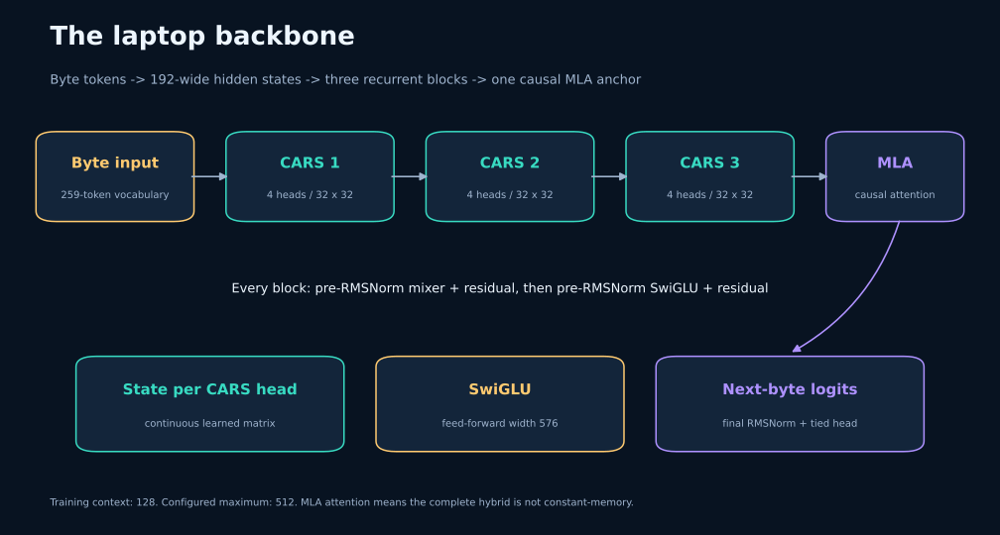
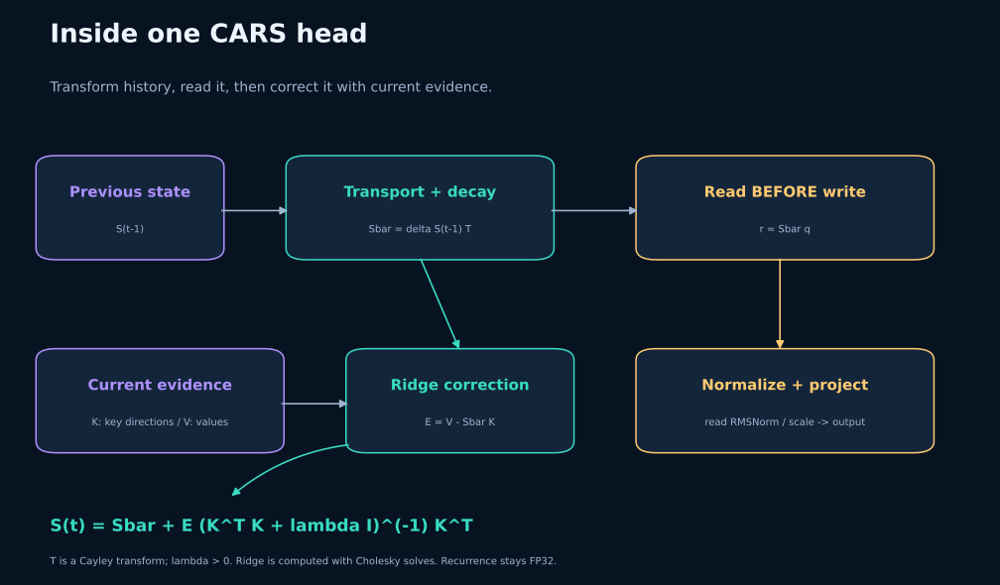

# CARS-R architecture and exact execution

## Scope

The implemented laptop model contains 2,044,068 parameters. Its schedule is
three CARS blocks and one causal MLA block, each with a pre-RMSNorm residual
mixer and a pre-RMSNorm SwiGLU residual. Width is 192, head count 4, FFN width
576, dropout zero, evidence rank 2 and maximum configured sequence length 512.
The published local training/evaluation uses 128-token windows.

Token IDs 0–255 represent UTF-8 bytes; PAD=256, BOS=257 and EOS=258. The output
head shares weights with the embedding. MTP steps=1 means no auxiliary future
prediction heads in the measured AR-only recipe.

## One recurrent head

Let the previous state be $S\in\mathbb R^{d_v\times d_k}$, with $d_v=d_k=32$.
For each input hidden vector, a linear projection produces query
$q\in\mathbb R^{d_k}$, rank-two key/value evidence
$K\in\mathbb R^{d_k\times2}$ and $V\in\mathbb R^{d_v\times2}$,
transport directions $u,w\in\mathbb R^{d_k}$ and a strength scalar.
Queries, key columns and transport directions are L2 normalized. Values are
unconstrained projected evidence. State is continuous learned memory, not an
explicit dictionary of people and objects.

The skew generator and Cayley map are

$$\Omega=\eta(uw^\top-wu^\top),\quad
\eta=0.25\tanh(s),\quad
T=(I-\Omega/2)^{-1}(I+\Omega/2).$$

For real skew $\Omega$, $T$ is orthogonal in exact arithmetic. State decays with
$\delta=\exp(-\operatorname{softplus}(\mathrm{raw\ decay}))$. Heads start with
log-spaced half-lives from 64 to 2048 tokens. Decay is static per learned head,
not an input-dependent forget gate. The transport strength initialization is
near identity.

The read occurs before current evidence is committed:

$$\bar S=\delta ST,\qquad r=\bar S q.$$

Read RMS normalization uses epsilon $10^{-6}$, then a positive learned
head-scale initialized at 0.1; a final output projection returns model width.

Evidence mismatch and write are

$$E=V-\bar S K,\qquad
G=K^\top K+\lambda I,\qquad
S'=\bar S+EG^{-1}K^\top.$$

Ridge starts at 0.01 with a configured minimum 0.001. Its positive
parameterization makes $G$ SPD. The implementation uses Cholesky solves.
The correction minimizes

$$\|\Delta K-E\|_F^2+\lambda\|\Delta\|_F^2.$$

This penalizes the update; it does not prevent changes to associations whose
key directions overlap. Minimum-change correction is not a guarantee that
unrelated objects stay intact.

## What the fast path changes

The original implementation already batches input/output projections across
the sequence, then computes transport and ridge solves inside the token loop.
The factorized path moves input-only work outside that loop:

$$U=\eta[u,-w],\quad W=[w,u],\quad
P=U(I-\tfrac12W^\top U)^{-1},\quad ST=S+(SP)W^\top.$$

The small Cayley system has an analytic 2×2 inverse. Ridge factors retain a
batched Cholesky solve, $R=G^{-1}K^\top$, for better behavior than an explicit
ridge inverse on nearly dependent evidence keys.

Prepare $C=[P,q,K]$, $D=[W,R^\top]$ and
$a=W^\top[q,K]$ for every token. Inside the token loop, compute
$Z=SC$, split its first two columns as $Z_P$, and evaluate

$$Z_r=\delta\big(Z_{\mathrm{rest}}+Z_Pa\big),\quad
r=Z_{r,\mathrm{query}},\quad E=V-Z_{r,\mathrm{keys}},$$

$$S'=\delta S+[\delta Z_P,E]D^\top.$$

This equals the original recurrence in real arithmetic. The last form avoids
the submitted prototype's $E/\delta$, which produced NaNs when decay underflowed
to zero. The loop uses two batched matrix multiplies and one multiply/add.
It remains sequential PyTorch; no prefix scan or fused CUDA kernel is claimed.

FP32 recurrence is explicit even with BF16 projections. Reordering arithmetic
changes rounding and can change a training trajectory. Diagnostics and
unsupported configurations use the original operator. Transport-disabled
controls retain the original path for exact cross-mode comparisons.

## Masks, boundaries and attention

Masked positions preserve the previous CARS state and zero the read.
EOS/BOS mark document boundaries but do not reset state inside a training
window. Every new window starts from an empty state.

MLA uses latent query/KV projections plus rotary components for causal
attention. This means the whole hybrid still includes attention costs and
memory, even though each CARS head has fixed state size. A states-only
continuation request is rejected for hybrid models because a matching MLA
cache/position offset has not been implemented. Generation uses bounded-context
recomputation. The included CPU TorchScript export is fixed at batch 1,
context 128, with padding and an attention mask.

## Stability and what was actually observed

For the default write, the homogeneous state factor is
$\delta T(I-KG^{-1}K^\top)$. Orthogonal transport, positive ridge and $0<\delta<1$
make this factor contractive in exact arithmetic. Additive value writes,
normalization, residuals, learned projections and gradients still matter:
this is not a global bounded-activation/gradient guarantee.

Historical health probes were finite; state norms were approximately 7–10
per head, with differentiated half-lives near 52/166/530/1670 tokens.
The speed run preserved single-object ownership and the two-object failure.
In the completed epoch, CARS head half-lives near step 2,800 were approximately
37/117/374/1176 positions, with variation across layers. These are decay-only
timescales, not measured recall horizons.
The matched epoch gave CARS Wiki NLL 1.38768. All four models reached 100%
single-object accuracy and 0% on both two-object stress suites, following the
latest recipient. Object-conditioned tracking remains an empirical research
problem. See [RESULTS.md](RESULTS.md).
