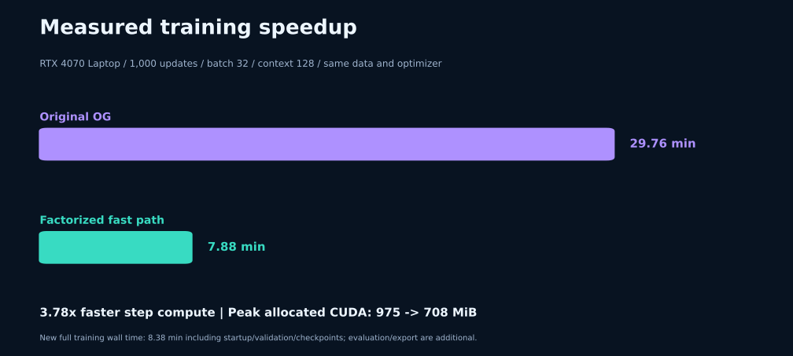
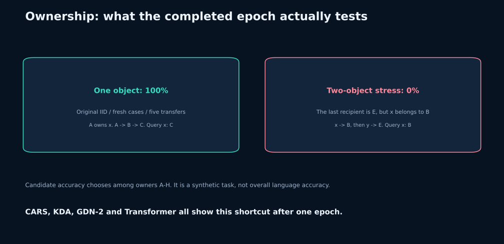

# Historical findings and current execution speed

These are completed experiments from 2026-10-05, retained as evidence in the
2026-10-10 standalone copy. Repackaging has not started another research run.
The requested one-epoch experiment is prepared, with no completed epoch result
claimed here. The superseded patch/workspace architecture is outside this repo.

## Original recipe and sample sizes

Seed 1337, 1,000 steps, batch 32, context 128, 4.096M prediction tokens,
AR-only, AdamW(0.9,0.95), LR peak 4e-4, weight decay 0.1, clipping 1,
100-step warmup, cosine floor 4e-5, BF16 CUDA projections and FP32 CARS state.
Validation chooses `best.pt`. Wiki evaluation covers 1,024 unique aligned
128-target windows (131,072 byte/special-token targets). Wiki NLL is natural-log
cross entropy per byte/special token, not word-level perplexity.

| Model | Wiki NLL ↓ | IID 500 | Five transfers 256 | Distractor 256 | Unchanged 256 | Training min |
|---|---:|---:|---:|---:|---:|---:|
| Original CARS-R | 1.54078 | 100% | 100% | 0% | 0% | 29.76 |
| Transformer | 1.52637 | 22.4% | 15.6% | 13.7% | 14.5% | 0.48 |
| KDA hybrid | 1.50294 | 98.0% | 98.8% | 1.6% | 0% | 7.98 |
| GDN-2 hybrid | 1.51235 | 99.8% | 100% | 0.4% | 0.4% | 7.83 |
| Fast CARS-R | 1.54021 | 100% | 100% | 0% | 0% | 7.88 |

All are approximately 2.04M parameters. Baseline timings describe these local
PyTorch implementations, not upstream fused kernels. Parameter matching does
not mean FLOP or kernel-efficiency matching. There is no repeated-seed evidence
that CARS has better general language modeling than KDA or GDN-2.

## Fast-path experiment

Logged training-step time: 1,785.68s → 472.72s (**3.78×**). New training wall
time: 8.38 min including subprocess startup, validation, health, checkpointing
and a two-step save/resume probe. Reference evaluation took approximately 110s
for the new model and 108s for original weights; faster-path evaluation took
24s; CPU export took 21s. These costs are outside logged training-step time.

Peak allocated CUDA memory: 975.1 → 708.3 MiB. Final validation AR loss:
1.42567 original versus 1.42633 fast. Both had finite logged gradients and
zero skipped updates. Wiki NLL difference -0.00057 is too small, in one seed,
to establish an accuracy gain. Same new weights evaluated with fast inference
had NLL 1.540210 versus 1.540214 with the reference operator.

The 2,000 additional unseen ownership cases scored 100% for both models.
They are unique and excluded from all original splits, but exclusion from
the finite generator changes the distribution: 1,999 have three transfers,
one has two. This is not an independent test of general reasoning.

## Ownership failure and interpretation

Candidate accuracy chooses among eight owners A–H after an appended space.
Random candidate chance is 12.5%. Unrestricted space/owner generation is
recorded separately in the raw results. The two-object suites deliberately
ensure the global last recipient is not the owner of the queried object.
CARS gets these cases wrong while single-object cases are perfect, consistent
with a last-recipient shortcut. Fast execution retains that failure pattern.
The synthetic training distribution contains one object per story.

## Numerical qualification

The historical fast-enabled compatibility suite passed 69 tests. Qualification
checks FP64/FP32 output, state and gradients, masks with holes, nonzero initial
state, collinear/near-collinear keys, coincident transport directions and zero
decay. Ordinary FP32 relative allowance is 0.005%; collinear stresses allow
0.1% because gradient cancellation is more sensitive. FP64 checks remain tight.
A ten-update matched BF16 trajectory had maximum loss difference 0.000130.
These checks support numerical agreement within tolerances, not bitwise
training identity or a universal stability guarantee.

## Evidence files

- [`../reports/initial_baselines.json`](../reports/initial_baselines.json): rounded initial table.
- [`../reports/original_reference.json`](../reports/original_reference.json): original checkpoint, same extended suites.
- [`../reports/fast_training_reference_eval.json`](../reports/fast_training_reference_eval.json): new weights, original operator.
- [`../reports/fast_training_fast_eval.json`](../reports/fast_training_fast_eval.json): same weights, faster operator.
- [`../reports/fast_training_metrics.jsonl`](../reports/fast_training_metrics.jsonl): complete step/validation/health log.
- [`../reports/historical_qualification.json`](../reports/historical_qualification.json): historical qualification, not a qualification stamp for a new checkout.
- [`../reports/historical_bf16_trajectory.json`](../reports/historical_bf16_trajectory.json): paired ten-step test.

Local checkpoint hashes and dataset manifests preserve artifact identity.
Personal absolute paths were removed from public-facing report copies.
